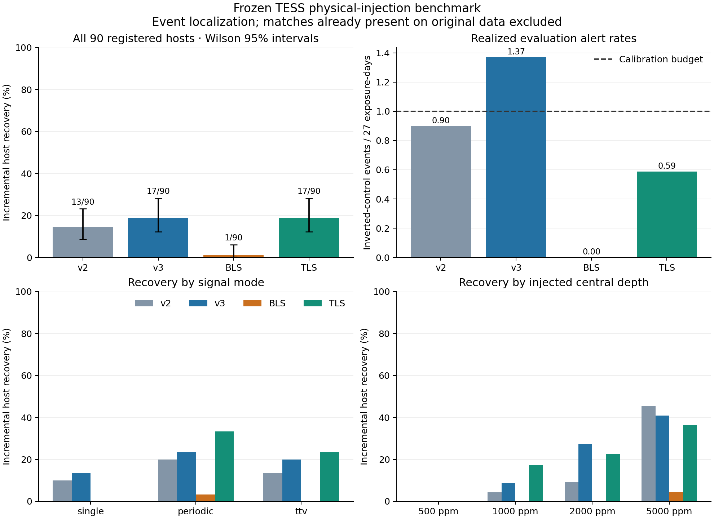

# Frozen physical-injection benchmark on 90 hosts

All 78 calibration hosts and all 90 development-disjoint evaluation hosts completed. Weights, injection schedule, and search settings were frozen before inference; BLS/TLS operating thresholds were frozen before evaluation.

v3 recovered 17/90 hosts versus v2's 13/90 (paired exact p=0.219). Its control-alert rate was 1.369 per 27 days against the frozen calibration budget of 1. TLS recovered 17/90 hosts and 88 individual events versus v3's 44, at 0.587 control alerts per 27 days.

| Method | Incremental host recovery | Incremental event recovery | Inverted alerts / 27 days |
| --- | ---: | ---: | ---: |
| v2 | 13/90 (14.4%) | 34/330 (10.3%) | 0.900 |
| v3 | 17/90 (18.9%) | 44/330 (13.3%) | 1.369 |
| BLS | 1/90 (1.1%) | 1/330 (0.3%) | 0.000 |
| TLS | 17/90 (18.9%) | 88/330 (26.7%) | 0.587 |

v3 recovered 17 hosts versus v2's 13 under the same new protocol. The shared calibration budget is at most 1 control events per 27 exposure-days; actual evaluation alert rates differ. The table must be read jointly across sensitivity and alert volume.

85/90 hosts had sufficiently observed injections; 5 lacked adequate transit coverage. The registered primary denominator remains 90. The recovery counts should not be interpreted as sensitivity conditional on having observed a transit.

## By signal mode

| Mode | Hosts | v2 recovered | v3 recovered | BLS recovered | TLS recovered |
| --- | ---: | ---: | ---: | ---: | ---: |
| periodic | 30 | 6 | 7 | 1 | 10 |
| single | 30 | 3 | 4 | 0 | 0 |
| ttv | 30 | 4 | 6 | 0 | 7 |

## Interpretation

Recovery requires a one-to-one event match within half the true transit duration. The primary metric removes matches already found in the original, uninjected observation. All 90 hosts remain in the denominator; raw matches and observable-event counts are retained in the machine-readable summary. This stricter matching differs from the previous trapezoidal audit, so its percentages are not directly comparable.

- v3_vs_bls: 16 v3-only recoveries, 0 other-only; two-sided exact McNemar p=3.052e-05, without multiplicity correction.
- v3_vs_tls: 8 v3-only recoveries, 8 other-only; two-sided exact McNemar p=1, without multiplicity correction.
- v3_vs_v2: 5 v3-only recoveries, 1 other-only; two-sided exact McNemar p=0.2188, without multiplicity correction.

BLS/TLS search one strongest periodic hypothesis from the exact injected aperture sums, using the same trial-period grid and blind detrending. v2/v3 scan pixels and light curves for local events. Single transits and TTVs probe different algorithmic capabilities; detection of an event does not establish a planet or recover its orbit. 6 injected durations exceed the neural models' frozen upper segment-duration prior; those hosts remain included.

Physical transit shapes use assumed stellar density and limb darkening, with an empirical static pixel template. The hosts are an archival sample previously scanned by v2, excluded from development, with one sector each. Inverted controls do not represent every astrophysical false positive. No watcher or website scoring was changed.

The coarse predeclared threshold grids achieved different calibration alert rates. BLS selected a depth-S/N threshold of 100; its recovery here does not establish an intrinsic limitation of BLS. A claim about the algorithms in general requires independently tuned baselines and a fresh evaluation cohort.

Background-source and eclipsing-binary injections, human/catalog review, repeated seeds, independently retrained ablations, and multi-sector tests remain necessary before broader claims or deployment.

- [Committed evidence summary](evidence.json)
- [Exportable figure](comparison.pdf)
- [Historical methods](../../archive/legacy-docs/ai_telescope_research.md)

Detailed protocol and per-host tables remain in local ignored outputs under
`outputs/research/ai_telescope/physical-benchmark-v1/`.
