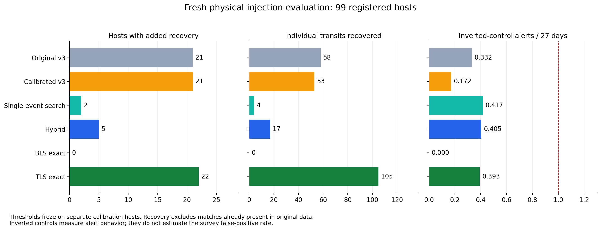

# Fresh-host recovery experiment

Calibrated v3 reduces control alerts from 0.332 to 0.172 per 27 days with 21/99 host recoveries, equal to the original v3 host count. Individual event recovery decreases from 58 to 53. The hybrid recovers only 5/99 hosts and is rejected. The weak-transit issue remains: every method misses all 25 registered 500 ppm injections. v3 single-transit recovery remains 4/33. The new BLS calibration is exact but still too conservative for useful recovery here.

99 registered hosts; 96 with observable physical injections.
All thresholds froze on 78 separate calibration hosts before evaluation. v3 weights are unchanged.
The new hybrid supplements v3 with a duration-aware single-event search. It is an experimental detector, not a new trained neural model.

| Method | Incremental hosts | Incremental events | Inverted alerts / 27 d |
| --- | ---: | ---: | ---: |
| v3_original | 21/99 | 58/326 | 0.332 |
| v3_calibrated | 21/99 | 53/326 | 0.172 |
| single_event | 2/99 | 4/326 | 0.417 |
| hybrid | 5/99 | 17/326 | 0.405 |
| bls_exact | 0/99 | 0/326 | 0.000 |
| tls_exact | 22/99 | 105/326 | 0.393 |

## Calibration

| Search | Threshold | Calibration alerts / 27 d | Conservative upper estimate |
| --- | ---: | ---: | ---: |
| bls_exact | 231.95611 | 0.000 | 0.045 |
| hybrid_neural | 0.985 | 0.000 | 0.045 |
| hybrid_single | 34.468069 | 0.106 | 0.248 |
| single_event | 32.731977 | 0.226 | 0.476 |
| tls_exact | 9.6635611 | 0.000 | 0.045 |
| v3_calibrated | 0.9 | 0.226 | 0.434 |

## by mode

| Factor | v3_original | v3_calibrated | single_event | hybrid | bls_exact | tls_exact |
| --- | ---: | ---: | ---: | ---: | ---: | ---: |
| single | 4/33 | 4/33 | 1/33 | 1/33 | 0/33 | 3/33 |
| periodic | 7/33 | 8/33 | 1/33 | 2/33 | 0/33 | 12/33 |
| ttv | 10/33 | 9/33 | 0/33 | 2/33 | 0/33 | 7/33 |

## by depth

| Factor | v3_original | v3_calibrated | single_event | hybrid | bls_exact | tls_exact |
| --- | ---: | ---: | ---: | ---: | ---: | ---: |
| 0.0005 | 0/25 | 0/25 | 0/25 | 0/25 | 0/25 | 0/25 |
| 0.001 | 3/25 | 4/25 | 0/25 | 0/25 | 0/25 | 6/25 |
| 0.002 | 5/25 | 5/25 | 0/25 | 1/25 | 0/25 | 5/25 |
| 0.005 | 13/24 | 12/24 | 2/24 | 4/24 | 0/24 | 11/24 |

The inverted-control rate is an alert diagnostic, not a survey false-positive rate. Calibration uses a 50% margin plus Poisson and host-bootstrap upper estimates; these do not guarantee performance under distribution shift.
Physical injections retain the earlier circular-orbit, synthetic-density, fixed limb-darkening and empirical-PSF assumptions. No background-source or binary rejection is established.
All registered hosts remain in denominators. Original-curve matches are subtracted before crediting one-to-one injection recovery.
This experiment does not validate the candidate classifier or justify deployment. See summary.json for paired comparisons; p-values are unadjusted.

## Grid resolution versus control margin

On the same 78 calibration controls, retaining the old empirical budget would give the following exact boundaries. They are calibration diagnostics only; neither fresh nor historical evaluation was rescored at these settings.

| Method | Original coarse threshold | Exact boundary at old mean budget | Calibration alerts / 27 d |
| --- | ---: | ---: | ---: |
| bls | 100 | 72.596780 | 0.921 |
| tls | 8 | 7.560412 | 0.981 |

The stricter thresholds in the evaluated recovery study come from the new transfer margin and host-cluster uncertainty rule, not from a coarse score grid.

The [committed evidence summary](evidence.json), [per-host results](host_recovery.csv),
and comparison figures are included here. Full run and calibration receipts
remain in local ignored outputs under `outputs/research/ai_telescope/recovery-v1/`.
